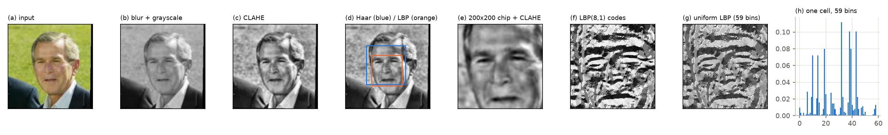

# FaceRoll: webcam attendance with Haar and LBP

Each student enrols their face once. The system then recognises faces live and
writes present/absent to a CSV for the day. Unregistered people show as
**Unknown** and are never logged.

It uses **classical image processing only**: Haar and LBP cascades, uniform LBP
histograms and χ² matching, with no neural network. It runs in real time
(about 20 fps) on a laptop CPU.

This is stage 2 of Case Study 9 (Image Processing, VJTI). Stage 1 surveyed the
methods and found the weakness that drives this stage: with the textbook LBPH
pipeline, **91% of strangers were accepted** as a registered student.

| | stage 1 (OpenCV LBPH) | **this system** |
|---|---|---|
| false boxes per frame (LFW mosaics) | 0.31 | **0.10** |
| LFW rank-1, 62 people | 56.6% | **67.3%** |
| students missed when ≤ 1% of strangers get in | 88.1% | **66.5%**, or **51.4%** with 2-frame fusion |
| Yale B, light 50–77° off-axis | 48.1% | **97.0%** (Tan–Triggs + LTP) |
| photo spoofing | accepted | optional blink check |

Full numbers: [docs/RESULTS.md](docs/RESULTS.md). The theory and what is new:
[docs/RESEARCH.md](docs/RESEARCH.md). How it was built:
[docs/WALKTHROUGH.md](docs/WALKTHROUGH.md).



## Setup

Python 3.10–3.12 and a webcam.

```bash
python -m venv .venv
source .venv/bin/activate            # Windows: .venv\Scripts\activate
pip install -r requirements.txt
python check_setup.py                # packages, cascades and the webcam
```

On Windows, `setup.bat` does all of this.

Use `opencv-contrib-python` 4.x, not plain `opencv-python`: the baseline LBPH
recogniser lives in `cv2.face`, and OpenCV 5 drops the Haar cascades.

## Run

```bash
python app.py                        # web dashboard -> http://127.0.0.1:8000
```

| channel | what it does |
|---|---|
| **Live** | A plain sentence says what the system sees and why ("closest is X, but not close enough: 0.58 vs 0.50"). **What the computer sees** switches the video to the pipeline's own images: contrast-fixed, LBP texture, and each detector's raw votes. **How it decided** shows the layers in 3D (face → texture codes → difference map → closest student) with meters against each limit. |
| **Enrol** | Name and roll number, then 30 guided webcam captures (blurred, dark or over-bright frames are refused), or import ≥ 10 photos. The model retrains automatically. |
| **Students** | Enrolled students; click a card to flip it and see the captures. |
| **Records** | One register per day, downloadable as CSV. |
| **How well it works** | The benchmark results; click a chart to flip it for a plain explanation. |
| **Settings** | Detector, lighting fix, LTP, limits, frames, blink check. *Tune for this class* measures the right limits on your own students. |


The original command-line tools still work and share the same pipeline:

```bash
python register.py                   # or: --from-folder photos/ --roll 12 --name "A B"
python train.py
python attendance.py                 # OpenCV window, q to finish
python evaluate.py                   # accuracy + suggested thresholds on your students
```

Output: `records/attendance_YYYY-MM-DD.csv` with `roll, name, status, time`. A
re-run on the same day keeps earlier Present marks.

## Pipeline

| stage | implementation | file |
|---|---|---|
| acquisition | `VideoCapture`, 640 px wide, mirrored | `utils.py` |
| noise | Gaussian 3×3 | `engines.py` |
| grayscale | Y = 0.299R + 0.587G + 0.114B | `engines.py` |
| contrast | CLAHE, clip 2.0, 8×8 tiles | `engines.py` |
| **detection** | **consensus**: Haar ∧ LBP cascade, or one of them plus an eye pair, or a Haar box with ≥ 20 neighbours | `detector.py` |
| normalisation | 200×200 chip; CLAHE, or Tan–Triggs (γ, DoG, equalisation) | `engines.py` |
| **features** | our NumPy LBP: uniform (59 bins), radii 1 and 2, 8×8 grid; optional LTP | `lbp.py` |
| **matching** | χ² with **learned per-cell weights**, minimum over each person's templates | `lbp.py`, `recognizer.py` |
| **open-set decision** | d₁ ≤ τ_d **and ratio test** d₁/d₂ ≤ τ_r | `recognizer.py` |
| temporal | IoU tracker; credited when accepted in **5 of the last 8 frames**; optional **blink** | `tracker.py`, `attendance.py` |
| output | CSV per day | `attendance.py` |

OpenCV's LBPH is kept as a baseline (`RECOGNIZER = "lbph"` in `config.py`).

## Reproducing the evaluation

```bash
python benchmark.py --lfw path/to/lfw_funneled --yale path/to/CroppedYale
python tests/smoke_test.py --lfw path/to/lfw_funneled
```

LFW can be fetched with `sklearn.datasets.fetch_lfw_people(data_home=...)`. The
benchmark writes `docs/results/*.json`, `docs/figures/*.png`, and the learned cell
weights in `assets/`.

## Files

| file | purpose |
|---|---|
| `app.py`, `static/` | web dashboard (Flask + plain HTML/CSS/JS, no build step) |
| `config.py` | every tunable parameter |
| `engines.py` | the pipeline shared by every entry point |
| `detector.py` | Haar / LBP / union / consensus detection, eye checks |
| `lbp.py` | LBP, uniform mapping, LTP, spatial histograms, χ², weight learning |
| `recognizer.py` | open-set LBP matcher and the OpenCV LBPH baseline |
| `tracker.py` | IoU tracking, confirmation streak, blink state machine |
| `attendance.py` | attendance session, CSV, CLI |
| `register.py`, `train.py`, `evaluate.py` | CLI enrolment, training, calibration |
| `benchmark.py` | all experiments and figures |
| `cascades/` | OpenCV's LBP cascades (not in the pip wheel), BSD licence |
| `assets/` | learned cell weights |
| `docs/` | research notes, results, walkthrough, figures |

`dataset/`, `models/` and `records/` are git-ignored: they hold face photographs
and attendance sheets.

## Known limits

* Frontal faces only: both cascades are frontal. A student must face the camera
  at some point in the session.
* Faces smaller than 80×80 px are ignored, so a large lecture hall needs a
  higher-resolution camera.
* The blink check stops printed photos but not a video replay.
* With only one student enrolled, the runner-up test can't run. Enrol at least two, and tune on three or more.
