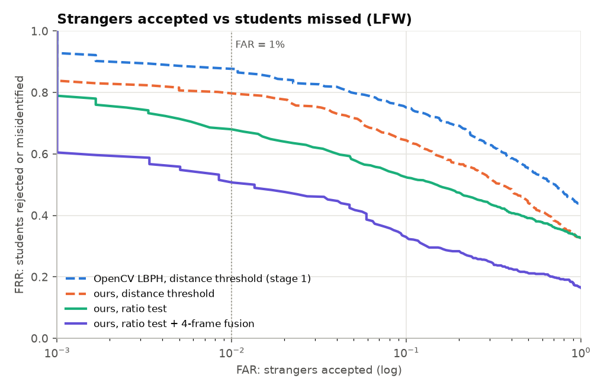

# Results

Everything here is reproduced by `python benchmark.py` (about 10 minutes on an
18-thread laptop CPU, no GPU). Raw numbers are in `docs/results/*.json` and the
figures in `docs/figures/`.

**Data.** LFW (deep-funneled, 250×250, from the scikit-learn mirror) and Extended
Yale B, cropped (38 subjects × 64 lighting directions, 2,414 readable images).

**Protocol** (as planned in the stage-1 report, §6.5):
* *Identification:* 5-fold per person. Train on 4 folds, test on the 5th.
* *Impostor test:* leave one person out of the gallery entirely; all their images
  are strangers.
* FAR = strangers accepted / all stranger probes. FRR = genuine probes that are
  rejected *or* given to the wrong student (eq. 6 of the report).
* The operating point is the most lenient threshold(s) with FAR ≤ 1%.

---

## 1. Detection: Haar vs LBP cascade vs consensus

250 frames of 640×500, each a 2×2 mosaic of random LFW photos (1,000 faces at known
positions). A box counts as correct if its centre is within 35 px of a face centre
and its width is 70–200 px. Any other box is a false box.

| detector | recall | false boxes / frame | ms / frame |
|---|---|---|---|
| Haar (`frontalface_default`, minNeighbors 6) | 98.4% | 0.31 | 27.9 |
| LBP cascade (`lbpcascade_frontalface_improved`) | 71.3% | 0.02 | **11.3** |
| Union | 98.7% | 0.32 | 39.2 |
| **Consensus (ours)** | **94.6%** | **0.10** | 39.6 |

Consensus removes two-thirds of Haar's false boxes and costs 3.8 points of recall.
In live use the tracker and the recognition threshold remove most of the
remaining false boxes. The LBP cascade's boxes are tighter than Haar's: the
median width ratio is 1.37, which is used to re-frame LBP-only boxes.

**Under lighting (Yale B, faces padded with a flat border):**

| subset (light angle) | 1 (≤12°) | 2 (≤25°) | 3 (≤50°) | 4 (≤77°) | 5 (>77°) |
|---|---|---|---|---|---|
| Haar | 54% | 54% | 40% | 42% | 4% |
| Haar + CLAHE | 35% | 39% | 30% | 42% | 8% |
| Consensus | 99% | 98% | 64% | 40% | 3% |
| Consensus + CLAHE | 98% | 95% | 62% | 45% | 8% |

*Caveat:* the Yale crops are tight (forehead to chin) and padded with a flat grey
border. The Haar cascade, trained on looser framing, finds them only half the time
even under frontal light, while the tighter LBP cascade does not have this
problem. This table therefore says more about framing than lighting for subsets
1–3. Subsets 4–5 show the real limit: past about 50° neither cascade sees half a
face in shadow, and CLAHE recovers only a few points.

## 2. Recognition on LFW (open set)

### 2a. Stage-1 replication: 10 people × 30 images (261 faces found)

| method | rank-1 | FRR @ FAR ≤ 1%, distance only | + ratio test | + 4-frame fusion |
|---|---|---|---|---|
| OpenCV LBPH (stage 1) | 70.9% | 84.3% | – | – |
| uLBP (8,1) | 70.9% | 85.1% | 77.0% | 40.0% |
| uLBP (8,1)+(8,2) | 73.2% | 84.3% | 74.3% | 30.0% |
| **uLBP (8,1)+(8,2), learned weights** | **77.0%** | 78.5% | **66.3%** | 42.0% |
| LTP (8,1)+(8,2), Tan–Triggs, weighted | 74.7% | 80.1% | 76.2% | **24.0%** |

The stage-1 report measured 76.6% rank-1 and 91.2% FAR at threshold 70 with the
same settings. Our re-run gives 70.9% and 83.9%. The difference most likely comes
from the LFW copy (the scikit-learn deep-funneled mirror) and the detector picking
a slightly different face set (4 images skipped). All rows in this table share
the same chips, so the comparison between methods is fair. With only about 65
groups of 4 frames, the fusion column is noisy (±6 points).

### 2b. Larger set: all 62 LFW people with ≥ 20 images, 20 each (1,201 faces)

| method | rank-1 | FRR @ FAR ≤ 1%, distance | ratio | distance ∧ ratio | 2-frame fusion |
|---|---|---|---|---|---|
| OpenCV LBPH (stage 1) | 56.6% | 88.1% | – | – | – |
| uLBP (8,1) | 52.5% | 88.2% | 82.7% | 82.2% | 68.9% |
| uLBP (8,1)+(8,2) | 56.7% | 86.4% | 80.8% | 78.9% | 64.6% |
| **uLBP (8,1)+(8,2), learned weights** | **67.3%** | 80.2% | 69.0% | **66.5%** | **51.4%** |
| LTP (8,1)+(8,2), Tan–Triggs, weighted | 59.9% | 83.3% | 84.3% | 78.7% | 68.6% |

At the chosen operating point the **wrong-student rate is 0.1%**. Almost every
error is a rejection ("not sure"), not a misidentification, which is the right
failure mode for attendance: a missed student can be marked by hand, but a false
mark is never noticed.

The default thresholds in `config.py` (τ_d = 0.38, τ_r = 0.88) come from this run.
LFW is far harder than one webcam in one room, so **recalibrate on your own class**
(Controls → Calibrate, or `python evaluate.py`).

## 3. Recognition under lighting: Extended Yale B

Gallery: subset 1 only (7 near-frontal-light images per person). Probes: subsets
2–5. Nearest neighbour, unweighted χ². Faces are the dataset's own aligned crops,
so this isolates illumination from detection.

| descriptor, normalisation | S2 | S3 | S4 | S5 |
|---|---|---|---|---|
| LBP 256-bin, none (≈ OpenCV LBPH) | 99.6% | 100% | 48.1% | 7.0% |
| uLBP (8,1)+(8,2), CLAHE | 99.6% | 100% | 62.7% | 13.7% |
| uLBP (8,1)+(8,2), Tan–Triggs | 100% | 100% | 86.2% | 50.8% |
| **LTP (8,1)+(8,2), Tan–Triggs** | **100%** | **100%** | **97.0%** | **58.8%** |

Subsets come from the light angle θ = arccos(cos A · cos E), with boundaries at
12°/25°/50°/77°. The probe counts (456 / 380 / 601 / 714) differ slightly from the
standard split for subsets 3 and 4.

CLAHE is the right default for a classroom: it is cheap and improves both
detection and recognition. Under strong side light, switch to **Tan–Triggs + LTP**
in Controls. That trades a few points on LFW-like variation for a very large gain
on shadows.

## 4. End-to-end smoke test (`tests/smoke_test.py`)

Four LFW people are enrolled from their first 25 photos, then the attendance
session is driven with photos the model has never seen:

* **4 of 4** enrolled people credited present (each from one of their first held-out photos)
* **0** credits from 50 photos of 5 people who were not enrolled
* the CSV has one row per student

## 5. Live

On this laptop (built-in 640×480 webcam, CPU only), the full pipeline runs at
17–27 fps in the web app: consensus detection, recognition of every face, tracking
and the explanation panel.

With 4 LFW identities enrolled, an unenrolled person at the camera was held at
d₁ ≈ 0.60–0.64 and d₁/d₂ ≈ 0.96–0.99, against τ_d = 0.38 and τ_r = 0.88. They
stayed **Unknown** throughout.
